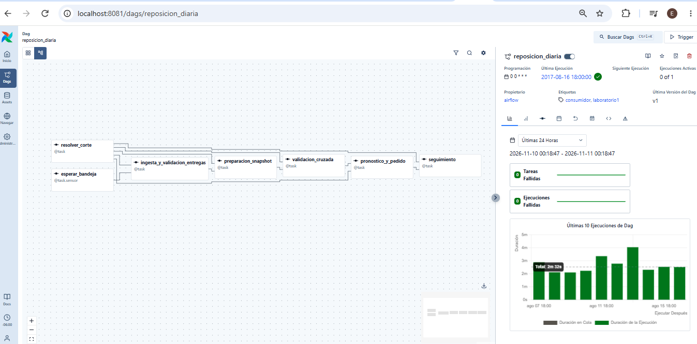
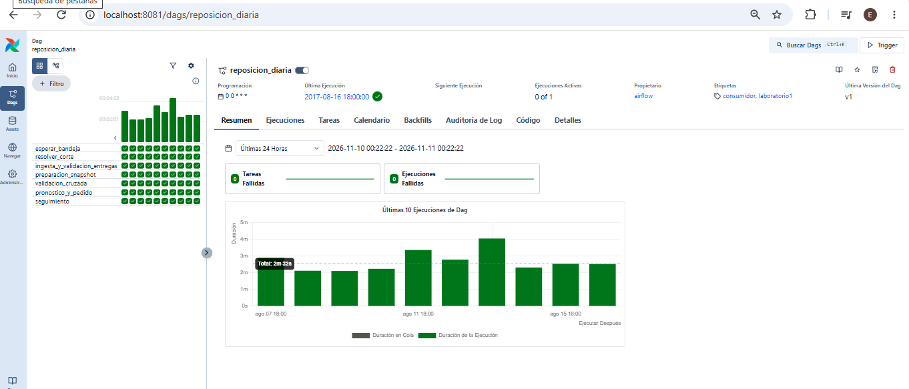
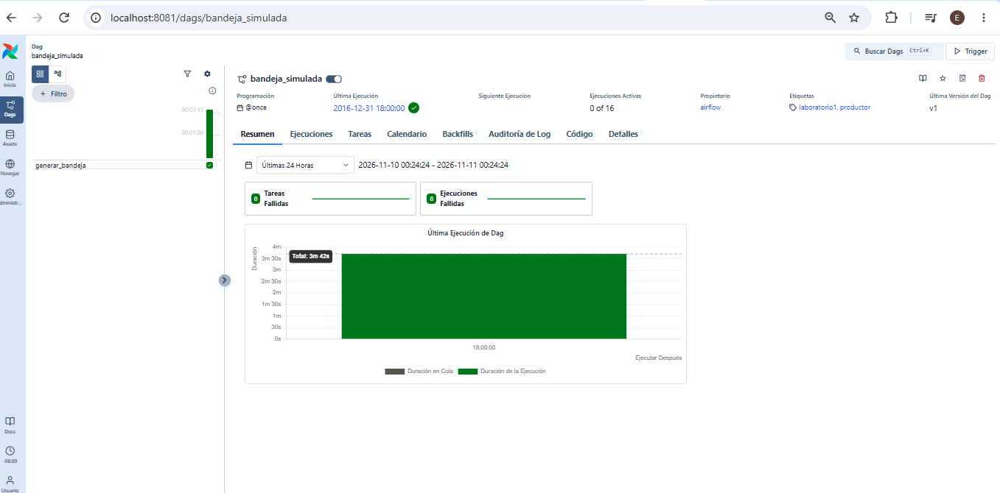
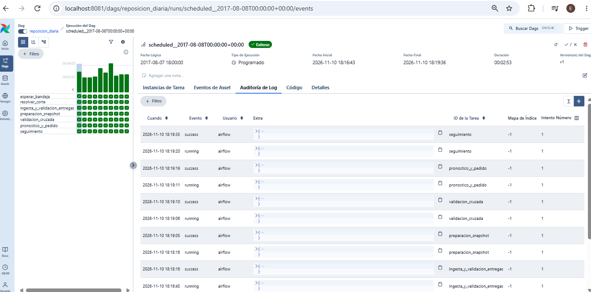
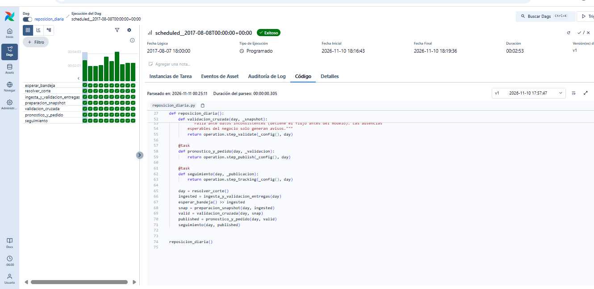

# Evidencia: interfaz de Airflow 3

Capturas de la interfaz de Airflow 3.3.2 (`http://localhost:8081`) del escenario `operacion-v1`, tomadas el 2026-11-10 después de la corrida completa (17 cortes) y del backfill del 08-03 al 08-05.

## Consumidor `reposicion_diaria`: grafo de tareas

Las 7 tareas por corte: la espera de la bandeja y la resolución del corte, la ingesta con validación, la preparación del snapshot, la validación cruzada, el pronóstico con pedido y el seguimiento. El panel derecho muestra 0 tareas y 0 ejecuciones fallidas.

## Consumidor `reposicion_diaria`: vista Grid

Todas las tareas están en `success`. La vista muestra las 10 corridas más recientes de las 17 (`@daily`, `catchup=True`, `max_active_runs=1`).

## Productor `bandeja_simulada`

DAG `@once`, separado del consumidor. Su única tarea, `generar_bandeja`, terminó en `success` y generó la bandeja inmutable en unos 3.7 minutos.

## Auditoría de una corrida (corte 2017-08-08)

Pestaña "Auditoría de Log" de la corrida `scheduled__2017-08-08`. Cada tarea pasa de `running` a `success` en orden. La corrida duró 2 min 53 s.

## DAG delgado: código visto desde Airflow

Pestaña "Código" de la corrida del 2017-08-08. Cada tarea solo llama a una función de `src/operation.py` (`step_validate`, `step_publish`, `step_tracking`…). Toda la lógica y sus pruebas están en `src/` y `tests/`.

## Log de `pronostico_y_pedido`: publicación e idempotencia (corte 2017-08-05)

Extracto de los logs de la tarea en Airflow (`/opt/airflow/logs/dag_id=reposicion_diaria/run_id=scheduled__2017-08-05T00:00:00+00:00/task_id=pronostico_y_pedido/`):

| Intento | Momento (UTC) | Origen | Valor devuelto |
|---|---|---|---|
| 1 | 2026-11-11 00:10:28 | Corrida programada | `{'status': 'published', 'publication': '…/operacion-v1/2017-08-05/751908fb5128', 'model_status': 'published', 'order_states': {'ready': 12474}}` |
| 2 | 2026-11-11 05:12:48 | Backfill del 08-03 al 08-05 | `{'status': 'already_published', 'publication': '…/operacion-v1/2017-08-05/751908fb5128', 'model_status': 'published'}` |

El backfill no creó otra publicación. Comparó byte a byte la existente (mismo identificador `751908fb5128`) y la conservó.
